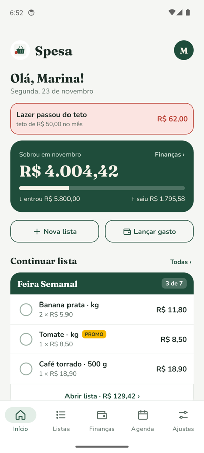
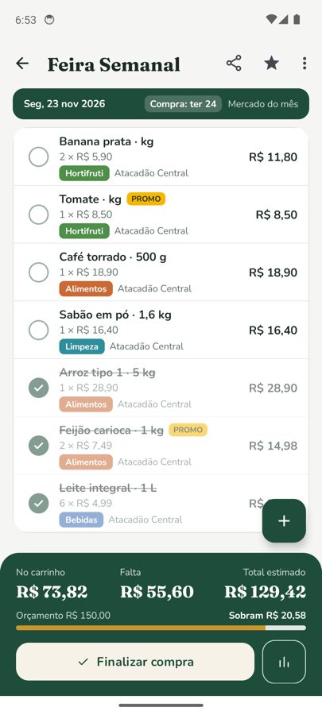
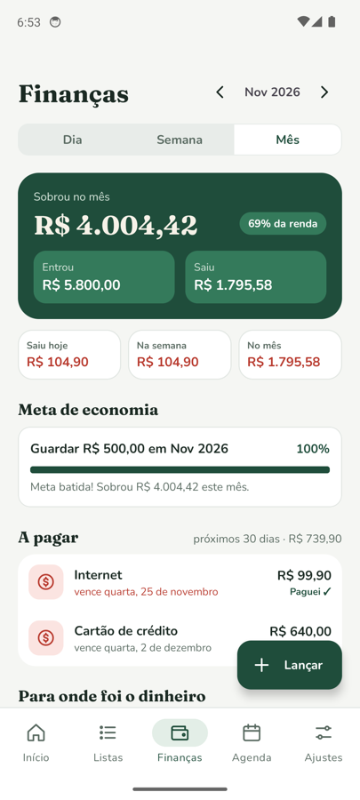
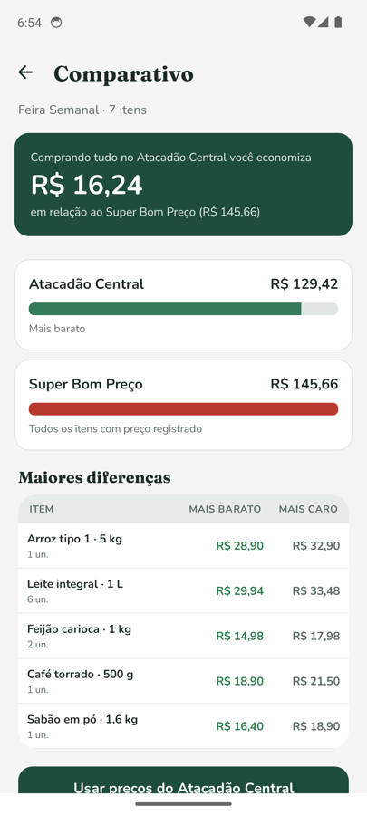
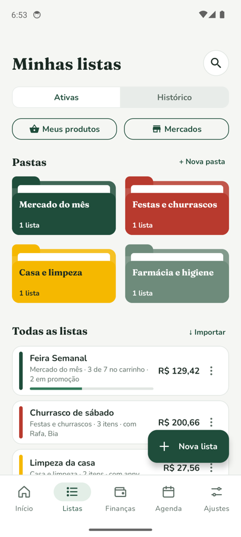
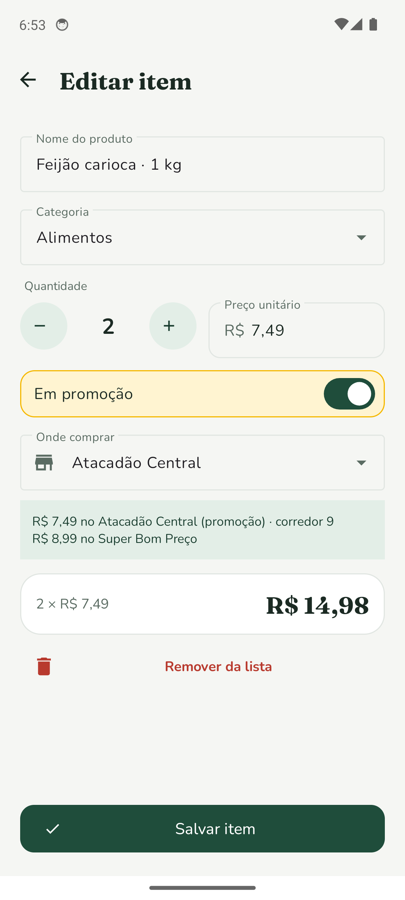
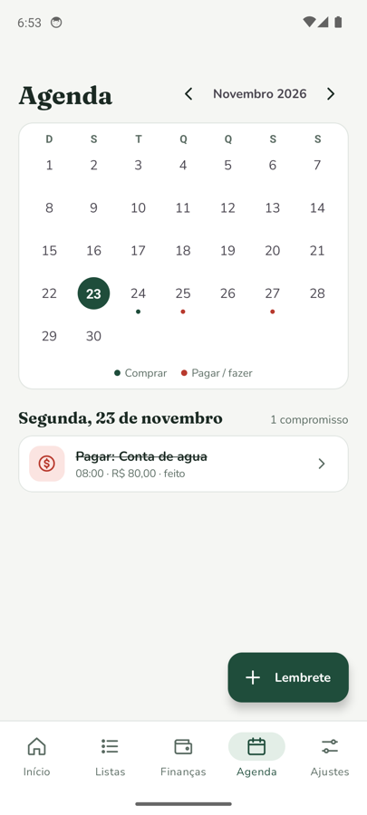
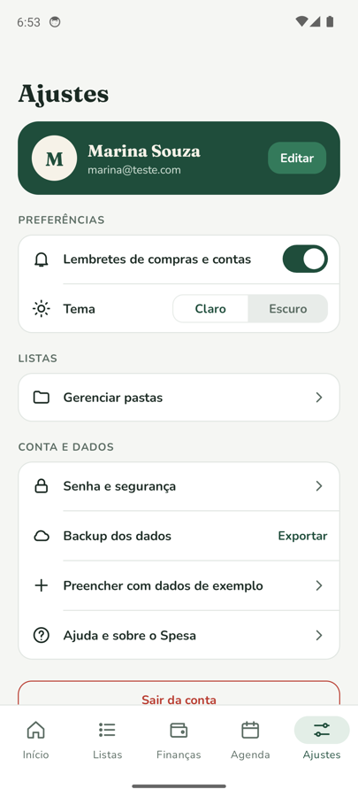

# Spesa

**Sua lista de compras inteligente.** App Android para listas de mercado, controle de gastos e agenda de compras.

Em italiano, *spesa* é a compra de mercado (*fare la spesa*) e também o gasto. As duas ideias do app em uma palavra.

<p>
  
  
  
  
</p>

## Como nasceu

A ideia veio de um problema do dia a dia: quem vai ao mercado sempre esquece alguma coisa. Um amigo chegou a fazer um protótipo em HTML que somava os valores, mas a lista ficava presa no navegador de um aparelho só. Somando isso à vontade de controlar gastos e ganhos sem planilhas cansativas, nasceu o Spesa.

## O que o app faz

- **Listas e pastas:** listas coloridas em pastas, histórico, duplicar e apagar.
- **Soma e orçamento:** total ao vivo enquanto você marca os itens, com barra de orçamento que muda de cor.
- **Meus produtos e mercados:** cada produto guarda o preço e o corredor em cada mercado. Tocando num mercado, você vê os produtos dele.
- **Comparar mercados:** uma lista inteira ou um produto só, mostrando onde sai mais barato.
- **Compartilhar:** uma lista ou uma pasta vira um código para mandar pelo WhatsApp. Quem recebe importa.
- **Finanças:** entradas e saídas por dia, semana ou mês, planilha exportável, meta de economia e teto de gasto por categoria.
- **Agenda:** lembretes de comprar, pagar e fazer, com notificação no celular. Contas que se repetem aparecem sozinhas todo mês.
- **Ajustes:** modo escuro, perfil, gerenciar pastas e dados de exemplo para ver o app cheio.

Tudo fica salvo no próprio celular. O app não precisa de internet nem de servidor.

## Telas

| Início | Listas | Item | Agenda | Ajustes |
|---|---|---|---|---|
|  |  |  |  |  |

## Feito com

- **Kotlin**, a linguagem oficial do Android
- **XML** para as telas, cores e ícones (Views + Material 3)
- **Gson** para guardar os dados como JSON no celular
- **Android Studio** e o **emulador Android** (Pixel 6) para programar e testar
- **Claude** para protótipos, ideias de telas e revisão de código
- Fontes **Fraunces** (títulos) e **Nunito** (textos), do Google Fonts

## Como o código está organizado

```
app/src/main/java/com/example/spesa/
├── model/        o formato dos dados (Lista, Item, Produto, Mercado, Lançamento, Lembrete)
├── dados/        Repositorio: o único lugar que lê e grava os dados
├── ui/           as telas (uma Activity por tela cheia, um Fragment por aba)
├── adaptadores/  as linhas das listas que rolam
└── util/         ajudantes: formato de reais e datas, janelas, lembretes, compartilhar
```

## Como rodar

1. Instale o [Android Studio](https://developer.android.com/studio).
2. Clone este repositório e abra a pasta no Android Studio (File › Open).
3. Espere o Gradle terminar de sincronizar.
4. Escolha um emulador ou um celular com Android 7.0 ou mais novo e clique em Run.

Na primeira vez, crie uma conta (ela fica só no celular). Em **Ajustes › Preencher com dados de exemplo** o app ganha listas, mercados e gastos de exemplo.

> Neste projeto o build é gerado fora da pasta (`~/.spesa-build`) porque a pasta original fica no iCloud. Se quiser o padrão, apague a linha `layout.buildDirectory` em `app/build.gradle.kts`.
